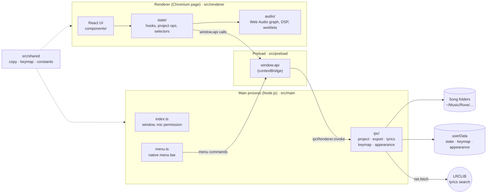
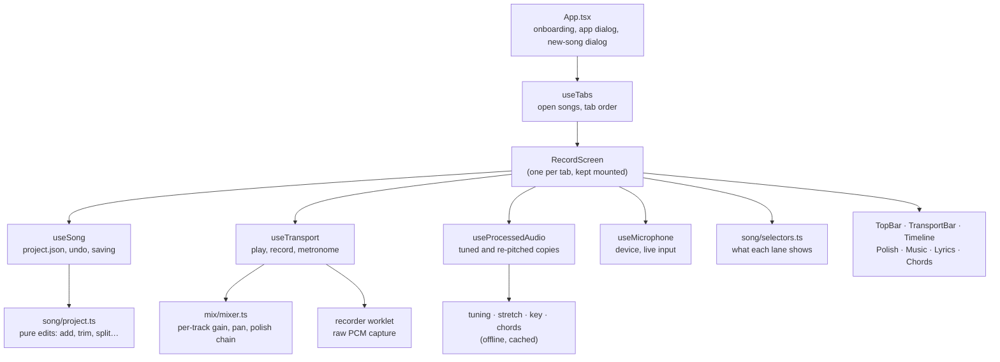
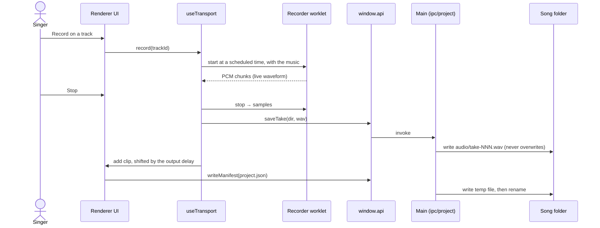
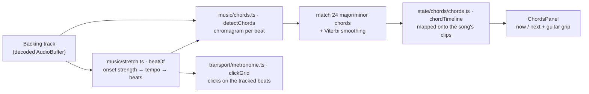

# Architecture

Rove is an Electron app: one **main process** (Node.js, with access to the file system
and macOS) and one **renderer** (a Chromium page running React and Web Audio). They
can't call each other directly; the **preload** script is the only bridge, exposing a
small, typed `window.api` to the page.

## Processes



- **Main** owns everything outside the page: opening and writing song folders, file
  dialogs, the menu bar, the theme, and the only network call (lyrics search). Every
  path that arrives over IPC is checked against the folders it opened for the renderer.
- **Preload** forwards a fixed list of calls and events; the page never gets Node.js.
  `contextIsolation` is on, so page scripts can't reach Electron internals.
- **Renderer** is the app the singer sees. All audio work happens here, in Web Audio.
- **Shared** code (copy strings, the keymap, constants) is used by both sides.

## Inside the renderer



- **Components** render and wire events; they don't decide what's allowed.
- **Hooks** own side effects: `useSong` loads and saves the project, `useTransport`
  starts and stops audio, `useMicrophone` holds the input stream.
- **Project operations** are pure functions returning a new project, which is what
  makes undo a simple history of snapshots.
- **Audio** builds the playback graph per session; heavy work (pitch correction, speed
  and key changes) renders offline into cached buffers so playback stays smooth.

## Recording a take



## Lyrics: searched online, by the main process

```mermaid
sequenceDiagram
  actor Singer
  participant P as LyricsPanel
  participant API as window.api
  participant M as Main (ipc/lyrics)
  participant L as LRCLIB

  Singer->>P: search "song and artist"
  P->>API: searchLyrics(query)
  API->>M: invoke
  M->>L: GET lrclib.net/api/search (net.fetch)
  L-->>M: results JSON
  M-->>P: parseSearchResults: validated, at most 12
  Singer->>P: pick a result
  P->>P: parseLyricsText: timed lines (LRC) into project.lyrics
  Note over P: while playing, activeLineIndex(position + offset)<br/>highlights the line; clicking a line seeks there
```

Only the main process goes online, and only with words the singer typed. Results are
checked before they reach the page, and the chosen lyrics are saved in `project.json`,
so they work offline afterwards.

## Song catalog: a database that ships with the app

Explore in the Songbook searches a curated catalog,
`resources/catalog/catalog.sqlite`. The main process opens it read-only with Node's
built-in `node:sqlite` (`ipc/catalog.ts`, queries in `main/catalog/query.ts`), so
searching never goes online. Songs still waiting for review are hidden.

The database file is the source of truth: there's no seed file to build it from.
Developers curate it with the scripts in `scripts/catalog/`:

| Command                                         | What it does                                                               |
| ----------------------------------------------- | -------------------------------------------------------------------------- |
| `npm run catalog:add -- "<title>" "<artist>" …` | Looks the song up on MusicBrainz and adds it; `--file` adds a list         |
| `npm run catalog:import -- --artists <list>`    | Adds each listed artist's most played songs (Deezer), pinned by ISRC       |
| `npm run catalog:review`                        | Songs that couldn't be placed for sure, with why and what to try           |
| `npm run catalog:remove -- <id>`                | Removes a song                                                             |
| `npm run catalog:setup` (runs on `npm install`) | Makes `git diff` show catalog changes as SQL rows instead of "binary file" |

The schema is versioned with SQLite's `user_version` (`main/catalog/schema.ts`); the
app ignores a file newer than it understands. Every song needs an ISRC, so later
sources (Deezer, LRCLIB) join on it rather than on names. API answers are cached in
`scripts/catalog/.cache/` (not committed).

## Chords and tempo: worked out on the device

Nothing is looked up. The backing track's own audio is analysed in the renderer:



Results are cached per audio buffer (`audio/dsp/renderCache.ts`), so switching tabs or replaying
doesn't analyse the song again.

## Where the audio work lives (`src/renderer/src/audio`)

| Folder        | What it does                                                                                                                       |
| ------------- | ---------------------------------------------------------------------------------------------------------------------------------- |
| `engine/`     | The AudioContext, mic devices and input, recorder setup, lining takes up                                                           |
| `mix/`        | The live graph: per-track gain, pan, mute and tone; playback; metronome clicks; meters and waveform peaks                          |
| `polish/`     | Polish settings mapped to the noise gate, EQ, compressor, de-esser and reverb                                                      |
| `pitch/`      | Sung-note detection, key finding, tuned copies rendered offline                                                                    |
| `separation/` | Vocal removal: SCNet in a worker with onnxruntime-web, on the CPU's threads                                                        |
| `music/`      | Beat tracking, time-stretch and pitch-shift for the backing track, chord detection; instrumentals' guitar, sampled piano and drums |
| `export/`     | Offline mixdown and loudness levelling                                                                                             |
| `encode/`     | WAV and MP3 encoding (takes and exports)                                                                                           |
| `dsp/`        | Shared maths: FFT, resampling, units, and the render cache                                                                         |
| `worklets/`   | Code that runs on the audio thread: the recorder and the noise gate                                                                |

Heavy work (tuning, speed and key, analysis, export) runs offline into buffers; live
playback only mixes what's ready. Recordings on disk are never changed: tuned and
re-pitched versions exist only in memory.

## Vocal removal: a model on the device

```mermaid
sequenceDiagram
  actor Singer
  participant P as MusicPanel
  participant H as useVocalRemoval
  participant W as separation worker
  participant API as window.api
  participant M as Main

  Singer->>P: Remove vocals
  P->>H: remove()
  H->>API: readSeparationModel()
  API->>M: invoke
  M-->>H: SCNet model bytes (13 MB, bundled, read once)
  H->>W: song's channels + model
  Note over W: @audio/neural-separate: 11 s segments, STFT,<br/>SCNet in onnxruntime-web (CPU threads), iSTFT
  W-->>H: progress … then the song minus its vocals
  H->>API: saveInstrumental(dir, song, wav)
  M->>M: write audio/<song> (no vocals).wav (never overwrites)
  H->>P: clips play the instrumental; withVocals remembers the song
```

The model runs inside the app with nothing online. onnxruntime-web only uses more than
one CPU thread when the page is cross-origin isolated, so the packaged app loads from an
`app://` protocol that sends those headers (`src/main/appProtocol.ts`) instead of
`file://`, and the dev server sends them too. "Put vocals back" switches the clips to
their original songs, which were never touched.

## What lives where on disk

| Where                              | What                                                    |
| ---------------------------------- | ------------------------------------------------------- |
| `~/Music/Rove/<Song>/project.json` | The song: tracks, clips, polish, music, lyrics          |
| `~/Music/Rove/<Song>/audio/`       | Takes and imported music; never modified or deleted     |
| `userData/state.json`              | Which songs were open, in tab order, and the active one |
| `userData/keymap.json`             | Shortcuts the singer rebound                            |
| `userData/appearance.json`         | Match System, Light or Dark                             |

## Building and shipping

`electron-vite` bundles the three parts into `out/`; `electron-builder` wraps them with
Electron into `Rove.app` and a `.dmg` per chip. Pushing a `v*` tag runs
`.github/workflows/release.yml`, which checks, builds and publishes the release.
